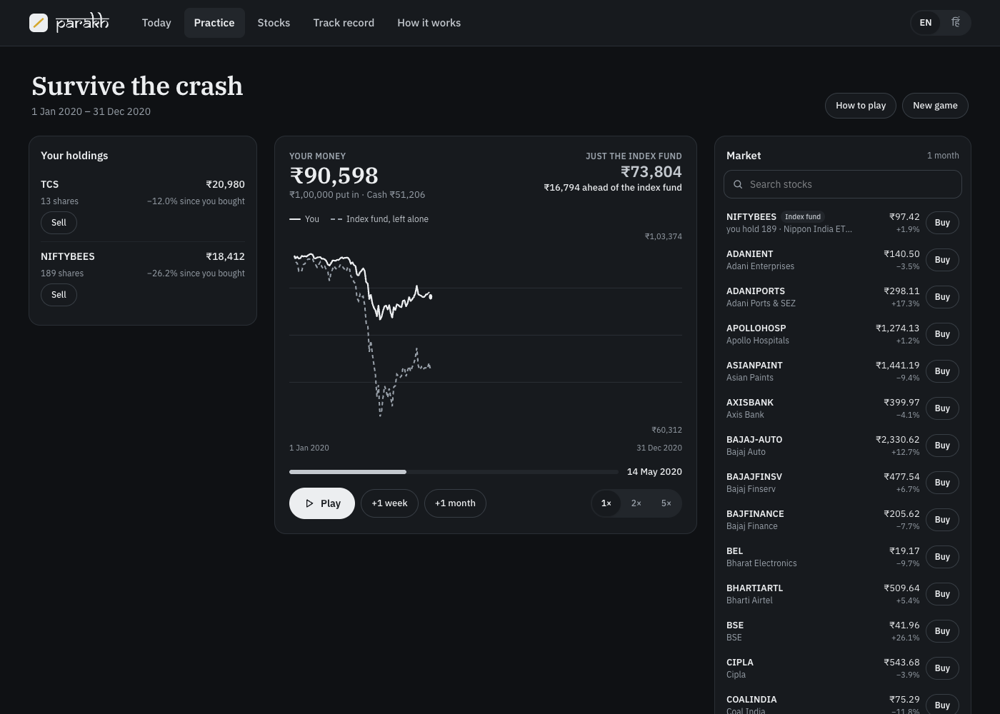
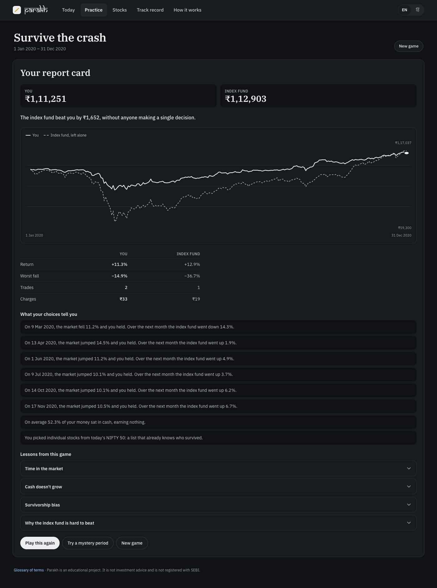
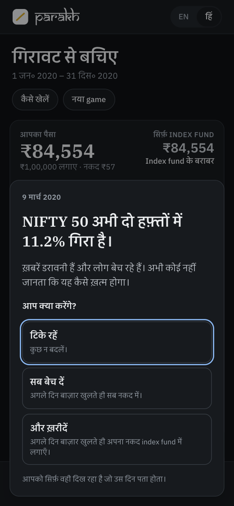
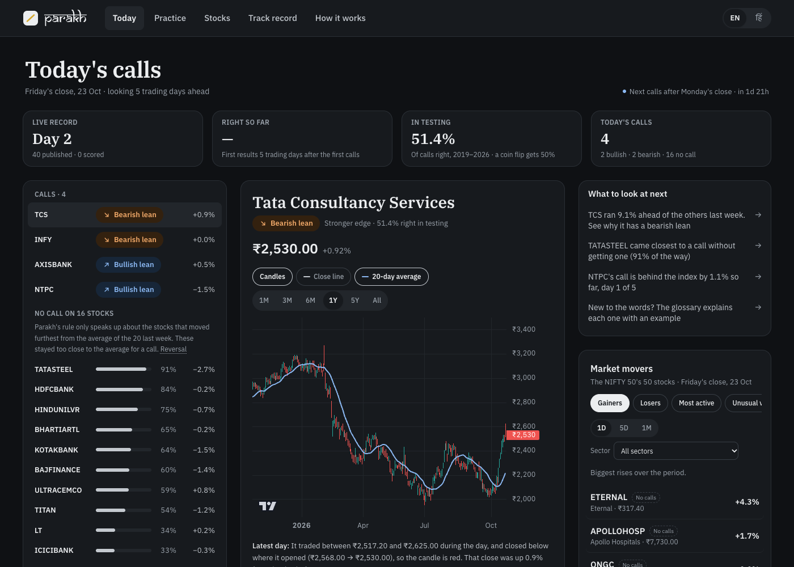
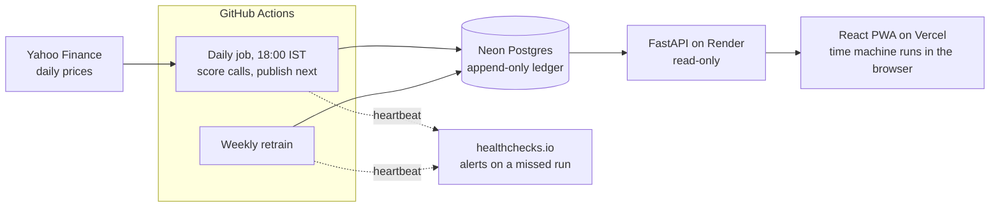

# Parakh

*Parakh (परख): to test something's true worth, the way a jeweller tests gold on a touchstone.*

**Practise investing with fake money, and see honestly what works.** A web app for beginner Indian investors. Replay real markets in a time machine, follow stock signals that show their track record, and judge everything against simply holding a NIFTY 50 index fund. In English and Hindi.

**Live app:** [parakh-bi78.vercel.app](https://parakh-bi78.vercel.app/) · [Decision log](docs/decisions.md) (45 decisions) · [PRD](docs/PRD.md) · [Model card](docs/model-card.md) · [SQL analysis](analysis/track_record_sql.ipynb)

> **The short version.** I set out to build an ML model that tells beginners whether a stock will beat the NIFTY 50 over the next week. Under rules written down before testing, a one-line rule matched a tuned LightGBM model, and on two years of held-back data neither was reliably better than a coin flip. So I stopped competing on accuracy. Parakh shows its receipts on every call, and teaches the lesson the data taught me through a game: picking stocks is hard, so measure everything against the index fund.

## What's in it

### The time machine: practice on real markets

- **Pick a period and an amount:** the 2020 crash, the 2021 rally, 18 flat months, a decade of SIP, or a **mystery** period with the dates hidden, so hindsight can't help.
- **Let time run:** buy and sell any NIFTY 50 stock or a real index fund (NIFTYBEES) with virtual money. Orders fill at the next day's open, in whole shares, with real charges itemised: STT, exchange fees, stamp duty, GST and the depository charge. Prices are adjusted for later splits, bonuses and dividends, so a share can look cheaper than it did at the time; gains in rupees work out the same.
- **The market interrupts you.** In a sharp fall or rally, or when your own money is 15% down, the game stops and asks: hold, sell or buy more? It shows only what you could have known that day.
- **A report card, not a score:** you against the same money left in the index fund, what followed each of your choices, and short lessons linked to what you did (selling in a fall, idle cash, charges, survivorship bias…). A win is called luck: one period proves nothing.
- **Shown, not told:** a picture strip and a spotlight tour on the first game, with "start here" nudges until the first order ([D-041](docs/decisions.md)).

  
  &nbsp;
  

### Signals with receipts

- **One honest question:** will this stock beat a NIFTY 50 index fund over the next 5 trading days? The answer is a *lean*, not an instruction, or *No call*.
- **A receipt on every call:** "Slight edge · 51.4% right in testing, 2019–26", with the unseen 2025–26 holdout one tap away, plus a range when a stock has done worse than a coin flip, so you can see how much of that could be chance.
- **Every no-call says why:** "3.5% behind the average; calls started at 3.8%", with a bar for how close it came ([D-035](docs/decisions.md)).
- **A laptop workspace:** stock list, selected stock's chart and reasons, and a rail with what to look at next ([D-038](docs/decisions.md)). Phones get a scrolling feed.
- **A record nobody can edit:** calls are published before the market opens, and the database refuses edits or deletions. Live and simulated records are never mixed, and the whole ledger downloads as a CSV.

### Context, in plain words

- **Charts a beginner can read:** zoomable candles since 2016, each day described in a sentence, and past calls marked right or wrong.
- **Hindi throughout the new screens,** in everyday Hindi that keeps the English market words people actually use, plus a 27-term glossary behind every dotted word ([D-034](docs/decisions.md)).
- **News is paused.** Headlines under the biggest movers were built ([D-037](docs/decisions.md)), then switched off: Google News feeds may only be shown in a personal feed reader. They come back only with a source whose terms allow public display ([D-042](docs/decisions.md)).

## What the data said

1. **The first model looked like it worked:** 51.2% right in a walk-forward test, and well calibrated.
2. **Measured properly, the edge vanished** (rank correlation on non-overlapping weeks, t ≈ 1.1). Its "worst year" was a calibration bug that had flipped the ranking upside down ([D-023](docs/decisions.md)).
3. **I fixed the rules before testing again** ([D-022](docs/decisions.md)): one metric, a pass bar, a list of allowed experiments, and 2025–26 held back for one final test. A one-line rule ("last week's laggards beat the index next week") passed; LightGBM didn't ([D-024](docs/decisions.md)).
4. **The holdout didn't hold up.** The rule ships, because switching to LightGBM on its holdout score would have meant choosing on the only clean test. The model card prints both as they came out.

Numbers as of model `reversal-20261015`, retrained 24 Oct 2026. Each weekly retrain re-downloads prices, so they move by a few tenths; the [model card](docs/model-card.md) always has the current run.

| Holdout 2025–26 (unseen until the final test) | Calls that were right | Rank IC (t-stat) |
|---|---|---|
| The rule (ships) | 48.7% of 2,188 calls | 0.017 (0.87) |
| LightGBM | 52.5% of 2,147 calls | 0.040 (1.46) |
| Coin flip | 50% | 0 |

Neither holdout result is statistically significant. On the research years (2019–24), the rule was right 52.1% of the time (IC 0.029, t = 2.39). The "51.4% right in testing" on each call covers 2019–26, research and holdout together, and each receipt says so.

Even at face value, the gap between bullish and bearish leans (about 0.2% over 5 days) is smaller than trading costs (about 0.25%), which the Track record screen states plainly. A [SQL analysis](analysis/track_record_sql.ipynb) of the record found that the "stronger edge" label did *worse* than "slight edge", so it was dropped ([D-032](docs/decisions.md)), and that the price feed has gaps on some trading days.

**One caveat applies to everything here: the stocks are today's index members,** picked in 2026, so companies that dropped out of the NIFTY 50 since 2019 are missing from both the backtest and the time machine. The [model card](docs/model-card.md) and the time machine's setup screen say so. A point-in-time universe is planned research.

## Key decisions

All 45 are in the [decision log](docs/decisions.md), each with the alternatives considered.

| Decision | Why |
|---|---|
| Compete on honesty, not accuracy ([D-001](docs/decisions.md)) | Short-term moves of large stocks can't be predicted much better than chance with public data. Promising accuracy invites overclaiming. |
| Judge against the index fund ([D-008](docs/decisions.md)) | It's a beginner's real alternative, and it stops a model scoring points just by following the market's mood. |
| Rules before results, and a holdout ([D-022](docs/decisions.md)) | With an edge this small, trying variants until one looks good produces luck, not signal. |
| Ship the simpler model ([D-024](docs/decisions.md)) | The ML didn't clearly beat one line of logic, and simpler can't hide anything. |
| From signals to practice ([D-033](docs/decisions.md)) | If even the model can't beat a coin flip, the most useful thing for a beginner is to learn that safely, with fake money. |
| Adjusted market prices, real charges, a real ETF ([D-039](docs/decisions.md)) | The index level leaves out dividends, and costs are what eat small edges. Without both, the game teaches the wrong lesson. |
| No accounts, no leaderboard, no live prices ([D-025](docs/decisions.md), [D-033](docs/decisions.md)) | Accounts add little to the lesson; ranking by profit rewards gambling; intraday ticks recreate the tips-group thrill. |
| Show how to play, don't tell ([D-041](docs/decisions.md)) | In the first real test, the player couldn't find where to start and left 98.6% of the money in cash. The rules were fine; the first minute wasn't. |

## What I'd do differently

- **Run the dumbest baseline first.** A one-line rule matched all the feature engineering.
- **Fix the test before the first experiment, not the twentieth.** Early results looked better than they were because the metric was still moving.
- **Put a real beginner in front of it sooner.** One session exposed the onboarding gap that weeks of building hadn't.

## How it works

- **Signals:** a reversal rule, logistic regression and LightGBM (SHAP explanations), compared under pre-registered rules. Explanations are fixed sentence templates, so a reason can't be made up.
- **Time machine:** a pure TypeScript engine replays a game from its saved orders, so a game can be resumed or replayed exactly. Its prices are a static file saved at build time and served by Vercel's CDN, rebuilt after each daily run, so Practice never waits for the API to wake ([D-044](docs/decisions.md)). Games are saved on the device.
- **App:** React, TypeScript and Tailwind, with types generated from the API schema and typed English/Hindi dictionaries (a missing Hindi line fails the build). It's an installable PWA.
- **Monitoring:** each job pings healthchecks.io, which emails if a run fails or doesn't arrive on time, and a monthly keepalive stops GitHub switching the schedules off after 60 quiet days ([D-043](docs/decisions.md)).
- **Quality:** 56 Python and 80 frontend tests, including look-ahead checks and engine tests on real 2020–23 prices.

Setup and deployment: [development guide](docs/development.md). The original screening-assignment notebook this grew from is in [`research/`](research/README.md), with its methodology issues listed.

## Disclaimer

Parakh is an educational project. It is not investment advice, and it is not registered with SEBI as an investment adviser or research analyst.

## Author

Vanshaj Verma · NSUT '27 · [GitHub](https://github.com/vanshajvr) · [LinkedIn](https://www.linkedin.com/in/vanshajverma60/)
