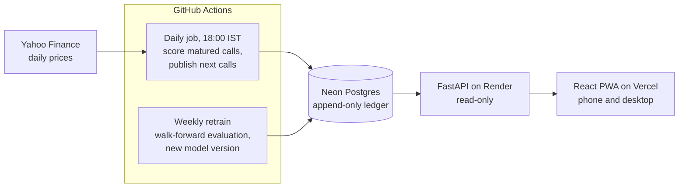

# Parakh

*Parakh (परख): to test something's true worth, the way a jeweller tests gold on a touchstone.*

**ML stock signals with receipts.** An installable web app for beginner Indian investors. Every call shows its track record, its confidence and its reasoning. It says "No call" when the data isn't clear, and it admits when its edge is too small to trade on.

**Live app:** [parakh-bi78.vercel.app](https://parakh-bi78.vercel.app/) · [Model card](docs/model-card.md) · [Decision log](docs/decisions.md) · [PRD](docs/PRD.md)

  
  &nbsp;
  

## The problem

Beginners in India get stock ideas from Telegram groups, finfluencers and YouTube. Those tips come with **no track record, no stated confidence and no reasoning**, so the loudest voice wins. SEBI's recent action against unregistered finfluencers shows how common this is.

## What Parakh does instead

- **Asks one honest question:** will this stock do better than a NIFTY 50 index fund over the next 5 trading days? For most beginners, the index fund is the real alternative.
- **Gives a lean, not an instruction:** *Bullish lean*, *Bearish lean*, or *No call*, with a confidence label.
- **Shows the receipt on every call:** for example, "Slight edge · 51.8% right in testing". That line never collapses away.
- **Explains in plain words:** what the call rests on, for example "over the past week it did 8.4% better than the average of the 20 stocks".
- **Shows calls in progress:** every earlier call is tracked day by day against the NIFTY 50 until it's scored, so the record visibly builds instead of appearing a week later. Once a day, from closing prices: no live tickers ([D-025](docs/decisions.md)).
- **Shows what the rule is looking at:** every stock's last 5 days against the others, the NIFTY 50, prices and a 1-month sparkline per stock, and the latest testing calls (labelled simulated) while live results build up ([D-026](docs/decisions.md)).
- **Keeps a public ledger:** calls are published before the market opens, and the database refuses any edit or deletion. Anyone can download the whole ledger as a CSV.
- **Warns where the model has struggled, with a range:** for example, "On ASIANPAINT: 47.4% in testing, below a coin flip (likely 41–54%)", so a user can see how much of that could be chance.

## Product decisions

Each of these is written up in the [decision log](docs/decisions.md), with alternatives and trade-offs.

| Decision | Why |
|---|---|
| **Compete on honesty, not accuracy** ([D-001](docs/decisions.md)) | Short-term direction of large stocks can't be predicted much better than chance with public data. A product that promises accuracy invites overclaiming. |
| **Predict "beats the index", not "price goes up"** ([D-008](docs/decisions.md)) | On "price goes up" the model had no edge (AUC 0.50), and its calls followed the market mood: bullish on 98% of stock-days in 2024. Measuring against the index removed that and matches the beginner's real choice. |
| **Size "No call" by coverage, not a fixed 55% threshold** ([D-010](docs/decisions.md)) | A weak, honest model rarely reaches 55%, so a fixed threshold would make the app say "No call" almost every day. |
| **"Biggest factors", never "because"** ([D-013](docs/decisions.md)) | The model often bets on reversals. "Bearish because it's up 10.9% this week" sounds illogical; "biggest factors" is faithful without implying simple causes. |
| **Receipts enforced by the database** ([D-015](docs/decisions.md)) | Append-only triggers and a strict publish window. A missed window stays a visible gap instead of being backfilled. |
| **Warn about weak stocks rather than hide them** ([D-019](docs/decisions.md)) | Quietly dropping the stocks below 50% would flatter the scoreboard, which is the cherry-picking Parakh exists to oppose. |
| **Write the rules down before testing, and keep a holdout** ([D-022](docs/decisions.md)) | With an edge this small, trying variants until one looks good produces luck, not signal. The bar, the metric and a 2025–26 holdout were fixed before any experiment. |
| **Ship a one-line rule over ML** ([D-024](docs/decisions.md)) | LightGBM didn't beat "last week's laggards beat the index" by the agreed margin, so the simpler rule ships, even though LightGBM looked better on the holdout. Choosing on the holdout would have spent the only clean test. |
| **An installable web app, details on demand** ([D-018](docs/decisions.md)) | One codebase for phones and laptops with no app store. User feedback on the first mockups ("too open and detailed") moved detail behind taps, but the receipts stayed visible. |

## Results, honestly

Walk-forward test: each year is predicted by a model trained only on earlier years. The model was chosen on 2019–2024; 2025–26 was kept back and checked once at the end.

| | Research years 2019–24 | Holdout 2025–26 | Coin flip |
|---|---|---|---|
| Calls that were right | **52.1%** | **48.8%** (2,181 calls) | 50% |
| Rank IC (t-stat) | 0.029 (2.39) | 0.018 (0.98) | 0 |
| Calibration error | 0.8 points | 0.6 points | — |

The edge passed the bar set in advance, then **didn't hold up on the holdout**: 2025 was fine (52.3%), 2026 was not (44.4%). The model card says so, and the live ledger will settle it.

**What the modelling pass found** ([model card](docs/model-card.md)):
- The old model's worst year (2021) was a calibration bug, not a bad model. The calibrator's slope came out negative and flipped the ranking. Calibration now uses several years of out-of-fold scores and abstains instead of inverting ([D-023](docs/decisions.md)).
- LightGBM with 15 features wasn't clearly better than one line of logic, and none of the extra features, alternative targets or longer horizons changed that.
- Per-stock "weak spots" were mostly noise: the old model's worst stock (ICICI Bank, 44.2%) is at 55.0% under the rule.

**Is it worth trading on? No.** Across all years, stocks with a bullish lean beat the index by 0.09% over 5 days on average, and bearish-lean stocks lagged it by 0.10%. That gap is smaller than typical trading costs (about 0.25%). The product says so on its Track record screen. The real test is the **live ledger**: calls published every trading day and scored in public, with no way to edit them afterwards.

## How it works

- **ML:** a reversal rule, logistic regression and LightGBM (15 price and volume features, SHAP explanations) compared by daily rank IC under pre-registered rules; the simplest model that clears the bar wins. Platt calibration on out-of-fold scores, with each day's calls centred on 50%. Explanations are fixed sentence templates.
- **Ledger:** calls and outcomes live in separate append-only tables. Every call records the model version that made it, and stored versions are never overwritten.
- **App:** React, TypeScript and Tailwind, with types generated from the API's schema. It installs as a PWA and works offline with the last saved calls.
- **Quality:** 39 Python tests (including look-ahead checks and live scoring matching the training label) and 27 frontend tests, all run in CI.

Setup and deployment: [development guide](docs/development.md).

## What's next

- **Let the live ledger judge the model.** Revisit after about 6 months of live calls, with any new idea pre-registered the same way before it's tested.
- **Hindi.** The typeface was chosen with a matching Devanagari version for this.
- **A daily digest** (email or Telegram), to meet users where the bad tips are.
- **"Explain this tip":** enter a stock a finfluencer mentioned and see what the data and the record say.

## Project history

This started as a company screening-assignment notebook: RSI and moving-average signals, a logistic regression on 6 months of data, and logging to Google Sheets. [`research/`](research/README.md) keeps that notebook and lists its methodology issues (look-ahead leakage, too little data, no baseline), each of which the rebuild fixes.

## Disclaimer

Parakh is an educational project. It is not investment advice, and it is not registered with SEBI as an investment adviser or research analyst.

## Author

Vanshaj Verma · NSUT '27 · [GitHub](https://github.com/vanshajvr) · [LinkedIn](https://www.linkedin.com/in/vanshajverma60/)
