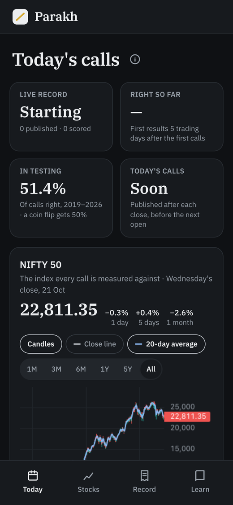
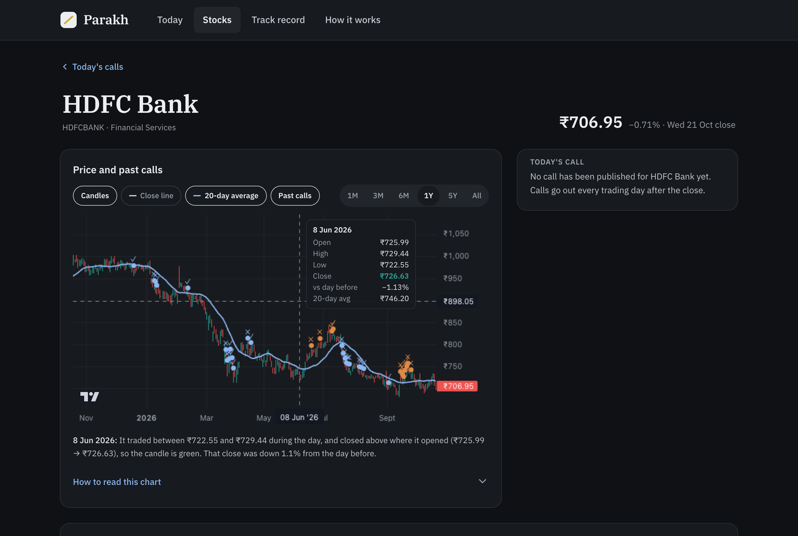
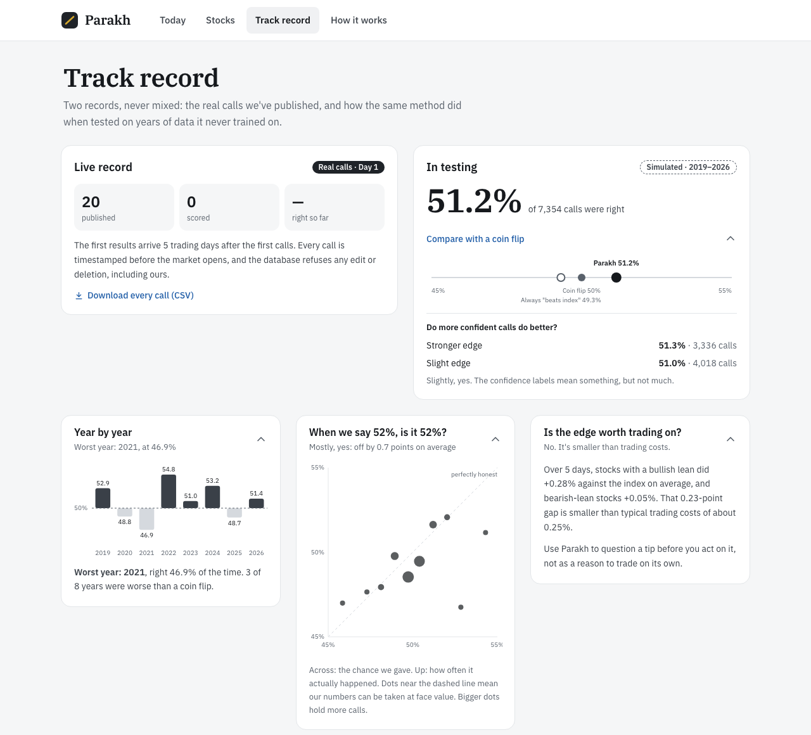
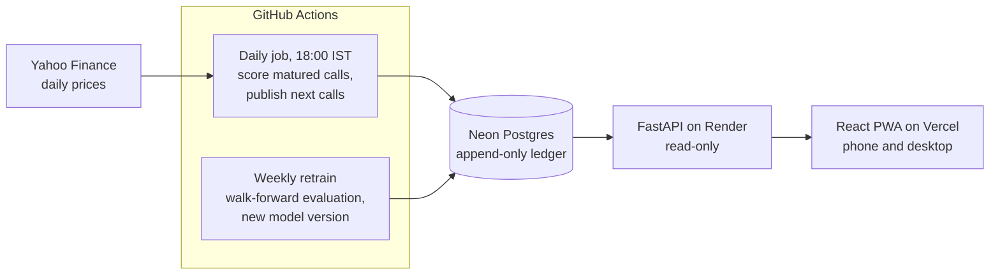

# Parakh

*Parakh (परख): to test something's true worth, the way a jeweller tests gold on a touchstone.*

**Stock signals with receipts, for beginner Indian investors.** Every call shows its track record, its confidence and its reasoning, says "No call" when the data isn't clear, and admits when its edge is too small to trade on.

**Live app:** [parakh-bi78.vercel.app](https://parakh-bi78.vercel.app/) · [Model card](docs/model-card.md) · [Decision log](docs/decisions.md) (29 decisions) · [PRD](docs/PRD.md)

> **The short version.** I set out to build an ML model that tells beginners whether a stock will beat the NIFTY 50 over the next week. With rules written down before testing, a one-line rule matched a tuned LightGBM model, and on two years of data held back until the end, neither was reliably better than a coin flip. So the product doesn't compete on accuracy. It competes on honesty: every number Parakh shows can be checked, and nothing it publishes can be edited afterwards.

## The problem

Beginners in India get stock ideas from Telegram groups, finfluencers and YouTube. Those tips come with **no track record, no stated confidence and no reasoning**, so the loudest voice wins. SEBI's recent action against unregistered finfluencers shows how common this is.

Parakh's bet: if a source showed its receipts (how often it has been right, how sure it is, and why), a beginner could judge it. The first source to hold to that standard should be Parakh itself.

## What happened

**1. The first model looked like it worked.** LightGBM on 15 price and volume features was right on 51.2% of its calls in a walk-forward test, and its probabilities were well calibrated. It was a small edge, and I designed the product around stating it honestly.

**2. A closer look said the edge wasn't real yet.** Measured properly, as a daily rank correlation counted only on non-overlapping weeks, the edge was statistically indistinguishable from zero (t ≈ 1.1). The model's "worst year" turned out to be a bug: in 2021 the calibration step had flipped the model's ranking upside down, so a model that was slightly right published calls that were slightly wrong ([D-023](docs/decisions.md)).

**3. I wrote the rules down before running anything else** ([D-022](docs/decisions.md)): one metric, a pass bar, a margin a complex model must win by, a list of the experiments allowed, and 2025–26 held back as a one-time final test. With an edge this small, trying variants until one looks good produces luck, not signal.

**4. A one-line rule beat the ML** ([D-024](docs/decisions.md)). "Last week's laggards tend to beat the index next week" passed the bar on 2019–24 (t = 2.39). LightGBM didn't (t = 1.80), and none of the pre-listed features, targets or horizons changed that.

**5. Then the holdout didn't hold up.** On 2025–26 the rule was right on 48.8% of calls, and LightGBM on 52.1%; neither is statistically significant. Switching to LightGBM on that basis would have meant choosing on the only clean test, so the rule ships, and the model card prints the holdout as it came out.

| | Research years 2019–24 | Holdout 2025–26 | Coin flip |
|---|---|---|---|
| Calls that were right | **52.1%** | **48.8%** (2,181 calls) | 50% |
| Rank IC (t-stat) | 0.029 (2.39) | 0.018 (0.98) | 0 |
| Calibration error | 0.8 points | 0.6 points | — |

**Is it worth trading on? No.** Across all years, stocks with a bullish lean beat the index by 0.09% over 5 days on average, and bearish-lean stocks lagged it by 0.10%. That gap is smaller than typical trading costs (about 0.25%), and the app says so on its Track record screen.

## What the product does with that

  
  &nbsp;
  

- **Asks one honest question:** will this stock do better than a NIFTY 50 index fund over the next 5 trading days? For most beginners, the index fund is the real alternative.
- **Gives a lean, not an instruction:** *Bullish lean*, *Bearish lean*, or *No call*, with a confidence label.
- **Shows the receipt on every call:** for example, "Slight edge · 51.8% right in testing". That line never collapses away.
- **Warns where it has struggled, with a range:** for example, "On ASIANPAINT: 47.4% in testing, below a coin flip (likely 41–54%)", so a user can see how much of that could be chance.
- **Keeps a public ledger:** calls are published after the close and before the next open, and the database refuses any edit or deletion. Anyone can download the whole ledger as a CSV.
- **Teaches the chart beginners see everywhere:** zoomable candlestick charts for the NIFTY 50 and every stock, back to 2016, with a 20-day trendline, a crosshair showing open, high, low and close, and each day readable in plain words ([D-029](docs/decisions.md)).
- **Shows calls in progress and what the rule sees:** each open call tracked day by day against the NIFTY 50, and every stock's last week against the others, from daily closes. There are no live tickers, on purpose ([D-025](docs/decisions.md)).

## Product decisions

Each is written up in the [decision log](docs/decisions.md), with the alternatives considered.

| Decision | Why |
|---|---|
| **Compete on honesty, not accuracy** ([D-001](docs/decisions.md)) | Short-term moves of large stocks can't be predicted much better than chance with public data. A product that promises accuracy invites overclaiming. |
| **Predict "beats the index", not "price goes up"** ([D-008](docs/decisions.md)) | On "price goes up" the model just followed the market mood (bullish on 98% of stock-days in 2024). The index comparison removes that and matches the beginner's real choice. |
| **Receipts enforced by the database** ([D-015](docs/decisions.md)) | Append-only triggers and a strict publish window. A missed window stays a visible gap instead of being backfilled. |
| **Warn about weak stocks rather than hide them** ([D-019](docs/decisions.md)) | Quietly dropping stocks below 50% would flatter the scoreboard, which is the cherry-picking Parakh exists to oppose. |
| **Rules before results, and a holdout** ([D-022](docs/decisions.md)) | The only way to trust a small edge is to fix the test before seeing the answer. |
| **Ship the simpler model** ([D-024](docs/decisions.md)) | The ML didn't clearly beat one line of logic. Simpler is easier to explain, and it can't hide anything. |
| **Daily candles, no live prices** ([D-025](docs/decisions.md)) | Mid-session swings mean nothing for a 5-day call and recreate the tips-group thrill. Real-time NSE data also needs a paid licence. |
| **An installable web app, details on demand** ([D-018](docs/decisions.md)) | One codebase for phones and laptops, with no app store. Feedback on the first mockups ("too open and detailed") moved detail behind taps, but the receipts stay visible. |

## What I'd do differently

- **Start from the user's job, not the model.** The PRD's job-to-be-done is "before I act on a stock idea, help me see what the data says". I built a scoreboard for Parakh's own calls first. The more useful product takes the user's tip as the input: how often has a move like that actually happened, what would it mean against an index fund, and what red flags are in the message. That works on day one, with no predictive edge needed.
- **Test the dumbest baseline first.** A one-line rule matched all the feature engineering. Running it on day one would have set the bar much earlier.
- **Fix the test before the first experiment, not the twentieth.** The early results looked better than they were because the metric and the evaluation were still moving.
- **Check data access before designing around it.** Licensed real-time NSE data isn't available to a project like this, and Yahoo's index data sometimes lags the stocks by hours. Both shaped the product late rather than early.

## How it works

- **ML:** a reversal rule, logistic regression and LightGBM (15 price and volume features, SHAP explanations) compared by daily rank IC under pre-registered rules; the simplest model that clears the bar wins. Platt calibration on out-of-fold scores, with each day's calls centred on 50%. Explanations are fixed sentence templates.
- **Ledger:** calls and outcomes live in separate append-only tables. Every call records the model version that made it, and stored versions are never overwritten.
- **App:** React, TypeScript and Tailwind, with types generated from the API's schema. It installs as a PWA and works offline with the last saved calls.
- **Quality:** 40 Python tests (including look-ahead checks and live scoring matching the training label) and 28 frontend tests, all run in CI.

Setup and deployment: [development guide](docs/development.md).

## What's next

- **Let the live ledger judge the method.** The ledger starts in late October 2026 and runs on its own; a fair first verdict needs about 6 months of calls.
- **"Check a tip":** paste a tip and see base rates, the index comparison and red flags (the job above).
- **Hindi.** The typeface was chosen with a matching Devanagari version for this.

## Project history

This started as a company screening-assignment notebook: RSI and moving-average signals, a logistic regression on 6 months of data, and logging to Google Sheets. [`research/`](research/README.md) keeps that notebook and lists its methodology issues (look-ahead leakage, too little data, no baseline), each of which the rebuild fixes.

## Disclaimer

Parakh is an educational project. It is not investment advice, and it is not registered with SEBI as an investment adviser or research analyst.

## Author

Vanshaj Verma · NSUT '27 · [GitHub](https://github.com/vanshajvr) · [LinkedIn](https://www.linkedin.com/in/vanshajverma60/)
