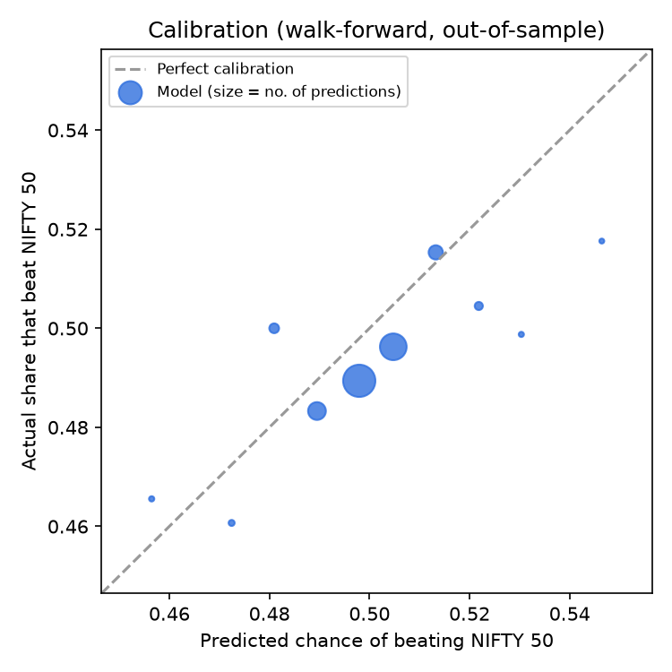

# Model Card

> Generated by `python -m jobs.retrain`. Don't edit by hand; change `ml/report.py` instead.
> Model version: `lightgbm-20261012`

## What it predicts

For each of 20 large NIFTY 50 stocks, after each trading day's close: **the probability
that the stock beats the NIFTY 50 index over the next 5 trading days.** The product turns that
probability into a *Bullish lean* (likely to outperform), a *Bearish lean* (likely to lag), or *No call*.

- **Intended use:** education. It helps beginners see what price data says about a stock compared
  with simply holding an index fund, and how reliable that has been.
- **Not intended for:** trading decisions, personalised advice, intraday use, or any stock outside the list.

## Data

- Daily adjusted prices from Yahoo Finance (via `yfinance`), 2016-01-01 onwards, plus the NIFTY 50 index.
- 52,140 labelled stock-days after indicator warm-up.
- Universe: HDFCBANK, ICICIBANK, SBIN, KOTAKBANK, AXISBANK, BAJFINANCE, TCS, INFY, RELIANCE, NTPC, ITC, HINDUNILVR, ASIANPAINT, TITAN, MARUTI, LT, TATASTEEL, ULTRACEMCO, BHARTIARTL, SUNPHARMA.

## Features

| Feature | Meaning |
|---|---|
| `ret_1d` | Return over the last session |
| `ret_5d` | Return over the past week (5 sessions) |
| `ret_20d` | Return over the past month (20 sessions) |
| `rsi_14` | RSI (14): momentum gauge; below 30 looks oversold, above 70 overbought |
| `macd_hist` | MACD histogram (scaled by price): whether short-term momentum is turning up or down |
| `dist_dma20` | Distance of the price from its 20-day average |
| `dist_dma50` | Distance of the price from its 50-day average |
| `dma20_vs_dma50` | Short-term (20-day) average vs longer-term (50-day) average |
| `vol_20d` | Volatility over the past month, annualised |
| `atr_pct` | Average true range (14) as a share of price: typical daily movement |
| `bb_pctb` | Bollinger %B: where the price sits within its recent range |
| `volume_z` | Today's trading volume vs the last 20 days |
| `mkt_ret_5d` | NIFTY 50 return over the past week |
| `mkt_ret_20d` | NIFTY 50 return over the past month |
| `rel_strength_20d` | Stock's past-month return minus the NIFTY 50's |

Three more features (12-month momentum, distance from the 52-week high, sector-relative return)
were tested and dropped because they didn't improve out-of-sample results (decision D-009).

## Method

- **Model:** lightgbm, chosen over the alternatives by out-of-sample Brier score, preferring the simpler
  model on a tie (decision D-012).
- **Calibration:** Platt scaling fitted on the most recent 20% of each training
  window, with a 5-day gap. Probabilities are centred on 50% within each day (decision D-011).
- **"No call" band:** sized on the calibration slice so that about 25% of stock-days
  get a call. The more confident half of calls is labelled *Stronger edge*, the rest *Slight edge* (decision D-010).
- **Evaluation:** walk-forward. Each year from 2019 is predicted by a model trained only on earlier
  data, with a 5-day gap so no training label overlaps the test year.

## Results (out-of-sample, 2019-01-02 to 2026-10-12)

### Models compared

| Model | Hit rate on calls | AUC | Brier | Calibration error | Coverage |
|---|---|---|---|---|---|
| logreg | 48.7% | 0.490 | 0.2501 | 1.6% | 22% |
| lightgbm | 51.2% | 0.509 | 0.2500 | 0.7% | 19% |
| *Coin flip* | 50.0% | 0.500 | 0.2500 | — | 100% |
| *Always "beats index"* | 49.3% | 0.500 | 0.2500 | — | 100% |

### Do more confident calls do better?

| Confidence | Calls | Hit rate |
|---|---|---|
| Slight edge | 3,982 | 50.6% |
| Stronger edge | 3,236 | 51.9% |

### Year by year

| Year | Coverage | Hit rate | AUC | Avg excess return after bullish | after bearish |
|---|---|---|---|---|---|
| 2019 | 18% | 51.1% | 0.509 | +0.66% | +0.22% |
| 2020 | 23% | 48.9% | 0.496 | -0.02% | -0.02% |
| 2021 | 12% | 45.5% | 0.477 | +0.25% | +0.72% |
| 2022 | 20% | 54.7% | 0.528 | +0.39% | -0.17% |
| 2023 | 33% | 52.2% | 0.513 | +0.09% | -0.06% |
| 2024 | 13% | 53.0% | 0.517 | +0.23% | +0.06% |
| 2025 | 11% | 49.6% | 0.510 | +0.07% | -0.05% |
| 2026 | 21% | 52.2% | 0.515 | +0.32% | -0.03% |

Worst year: **2021**, with a hit rate of 45.5%.

### Fewer vs more calls (what-if)

| Target coverage | Actual | Hit rate | Excess after bullish | after bearish |
|---|---|---|---|---|
| 5% | 5% | 51.7% | +0.12% | -0.03% |
| 10% | 10% | 51.3% | +0.22% | +0.03% |
| 25% | 25% | 51.2% | +0.22% | +0.02% |
| 50% | 50% | 51.3% | +0.24% | +0.03% |
| 100% | 100% | 50.7% | +0.15% | +0.05% |

## Honest summary

- The model has a **small edge**: 51.2% of its calls were right, against 50% for a coin flip, and it is
  well calibrated (calibration error 0.7%).
- Over 5 days, stocks with a bullish lean did +0.23% relative to the index on average,
  and stocks with a bearish lean did +0.04%. The gap (+0.19%) is **smaller than a typical
  round-trip trading cost of about 0.25%**, so trading on these signals alone would not be expected to make money.
- The edge varies from year to year and has been negative in some years (see the table above).

## Limitations

- Uses price and volume only: no fundamentals, news or earnings dates.
- Large, liquid stocks are the hardest to predict. This is expected behaviour, not a bug.
- yfinance data can be delayed or revised.
- Past out-of-sample performance does not guarantee future performance. The live ledger is the real test.

## Disclaimer

This is an educational project. It is not investment advice, and it is not registered with SEBI.
